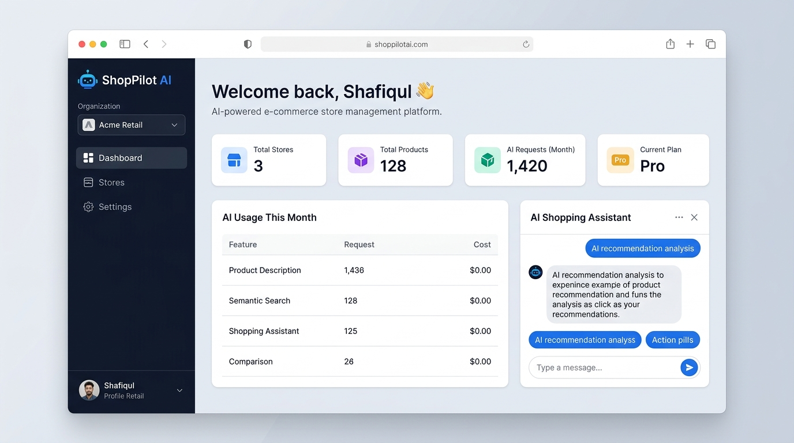

# 🛒 ShopPilot AI

> An AI-powered e-commerce management platform built as a monorepo — Laravel 10 REST API backend + Next.js 14 App Router frontend.



---

## 📁 Monorepo Structure

```
ShopPilot-AI/
├── assets/                 # Project assets and screenshots
│   └── dashboard-preview.jpg
├── api/                    # Laravel 10 REST API backend
│   ├── app/
│   │   ├── Http/
│   │   │   ├── Controllers/Api/V1/
│   │   │   │   ├── AuthController.php
│   │   │   │   ├── OrganizationController.php
│   │   │   │   ├── StoreController.php
│   │   │   │   ├── ProductController.php
│   │   │   │   ├── ProductCategoryController.php
│   │   │   │   └── AiController.php
│   │   │   ├── Middleware/
│   │   │   ├── Requests/
│   │   │   └── Resources/
│   │   ├── Models/
│   │   │   ├── User.php
│   │   │   ├── Organization.php
│   │   │   ├── Store.php
│   │   │   ├── StoreSetting.php
│   │   │   ├── Product.php
│   │   │   ├── ProductCategory.php
│   │   │   ├── ProductImage.php
│   │   │   ├── ProductTag.php
│   │   │   ├── ProductEmbedding.php
│   │   │   ├── AiUsageLog.php
│   │   │   ├── UserInvitation.php
│   │   │   └── AuditLog.php
│   │   ├── Services/
│   │   │   ├── AI/              # OpenAI HTTP client, embedding, description, chat, compare
│   │   │   ├── OrganizationService.php
│   │   │   ├── StoreService.php
│   │   │   └── ProductService.php
│   │   └── Traits/
│   ├── config/
│   │   └── ai.php               # OpenAI config, budgets & feature flags
│   ├── database/migrations/
│   └── routes/
│       └── api.php              # Versioned API routes (v1 — 37 routes)
│
├── frontend/               # Next.js 14 App Router dashboard
│   ├── src/
│   │   ├── app/
│   │   │   ├── (auth)/
│   │   │   │   ├── login/
│   │   │   │   └── register/
│   │   │   ├── (dashboard)/
│   │   │   │   ├── dashboard/
│   │   │   │   ├── stores/
│   │   │   │   │   ├── new/
│   │   │   │   │   └── [storeSlug]/
│   │   │   │   │       └── products/
│   │   │   │   └── settings/
│   │   │   ├── globals.css
│   │   │   └── layout.tsx
│   │   ├── components/
│   │   │   ├── ai/              # AI Hub (Chat, Semantic Search, Comparison)
│   │   │   ├── categories/      # Categories tab & dialog
│   │   │   ├── layout/          # Sidebar, AppLayout, PageHeader
│   │   │   ├── products/        # Products tab & Product form
│   │   │   ├── stores/          # Store settings form
│   │   │   └── ui/              # Button, Card, Dialog, Badge, Input, Select, Tabs, etc.
│   │   ├── hooks/               # TanStack Query custom hooks (useAuth, useStores, useProducts, useAi)
│   │   ├── lib/                 # Axios client, TypeScript types, formatters
│   │   └── store/               # Zustand auth & org persistence store
│   ├── tailwind.config.ts
│   ├── tsconfig.json
│   └── package.json
└── README.md
```

---

## 🚀 Tech Stack

| Layer        | Technology                                                      |
|--------------|-----------------------------------------------------------------|
| **Backend**  | Laravel 10, PHP 8.1+                                           |
| **Frontend** | Next.js 14 (App Router), TypeScript, Tailwind CSS, shadcn/ui    |
| **Client State** | Zustand (with localStorage persistence)                     |
| **Server State** | TanStack Query v5 (React Query)                             |
| **Auth**     | Laravel Sanctum (Bearer token)                                  |
| **Permissions** | Spatie Laravel Permission 6.0                                |
| **AI Models**| OpenAI GPT-4o + text-embedding-3-small                          |
| **HTTP**     | Guzzle 7 (API) / Axios with interceptors (Frontend)             |

---

## 🔑 Key Features

- **Multi-Tenant Organizations**: User-organization relationships with role-based access (`org_admin`, `store_manager`, `customer`).
- **Store Management**: Multiple stores per organization with individual currencies, locales, timezones, and settings.
- **Product Catalog**: Full product CRUD, SKU tracking, stock management, categories with hierarchy, and tag tagging.
- **AI Hub & Automation**:
  - 🤖 **Shopping Assistant**: Context-aware chat assistant for customer interactions.
  - 🔍 **Semantic Search**: Vector embeddings with cosine similarity matching for natural language product searches.
  - 📊 **Product Comparison**: Side-by-side AI comparison of 2–4 items with recommendations.
  - ✨ **Description Generator**: SEO-friendly product copy generation using GPT-4o.
  - 📈 **Usage & Cost Tracking**: Token accounting and monthly breakdown per organization.

---

## ⚙️ API Endpoints Summary (37 Routes)

All routes live under `/api/v1/`.

### 1. Auth (Public & Protected)
- `POST /api/v1/auth/register`
- `POST /api/v1/auth/login`
- `POST /api/v1/auth/logout`
- `GET  /api/v1/auth/me`
- `POST /api/v1/auth/email/verification-notification`
- `POST /api/v1/auth/invitations/{token}/accept`

### 2. Organizations
- `GET|POST /api/v1/organizations`
- `GET|PUT  /api/v1/organizations/{org}`
- `GET      /api/v1/organizations/{org}/members`
- `POST     /api/v1/organizations/{org}/members/invite`
- `DELETE   /api/v1/organizations/{org}/members/{user}`
- `PATCH    /api/v1/organizations/{org}/members/{user}/role`
- `GET      /api/v1/organizations/{org}/ai/usage`

### 3. Stores & Settings
- `GET|POST   /api/v1/organizations/{org}/stores`
- `GET|PUT|DELETE /api/v1/organizations/{org}/stores/{store}`
- `GET|POST   /api/v1/organizations/{org}/stores/{store}/settings`

### 4. Products & Categories
- `GET|POST   /api/v1/organizations/{org}/stores/{store}/products`
- `GET|PUT|DELETE /api/v1/organizations/{org}/stores/{store}/products/{product}`
- `GET|POST   /api/v1/organizations/{org}/stores/{store}/categories`
- `GET|PUT|DELETE /api/v1/organizations/{org}/stores/{store}/categories/{category}`

### 5. AI Capabilities
- `POST /api/v1/organizations/{org}/stores/{store}/ai/chat`
- `POST /api/v1/organizations/{org}/stores/{store}/ai/search`
- `POST /api/v1/organizations/{org}/stores/{store}/ai/compare`
- `POST /api/v1/organizations/{org}/stores/{store}/products/{product}/ai/description`
- `POST /api/v1/organizations/{org}/stores/{store}/products/{product}/ai/embed`

---

## 🛠️ Local Setup

### 1. Backend (`/api`)

```bash
cd api

# Install PHP dependencies
composer install

# Configure environment
cp .env.example .env
php artisan key:generate

# Set up database credentials in .env, then migrate:
php artisan migrate

# Start backend server
php artisan serve
```

### 2. Frontend (`/frontend`)

```bash
cd frontend

# Install Node dependencies
npm install
# or
pnpm install

# Start Next.js development server
npm run dev
```

Visit `http://localhost:3000` to access the ShopPilot AI dashboard.

---

## 🗺️ Roadmap & Progress

- [x] **Phase 1: Foundation** — Monorepo, Laravel 10 API, Sanctum Auth, Multi-tenant Organizations, Spatie Roles, Audit Logs.
- [x] **Phase 2: Store & Product Management** — Store CRUD, Store Settings, Products, Categories, Tags, and Soft Deletes.
- [x] **Phase 3: AI Integration** — OpenAiClient (Guzzle), AI Usage Tracking, Product Description Generator, Vector Embeddings & Semantic Search, Chat Assistant, Product Comparison.
- [x] **Phase 4: Next.js 14 Frontend** — App Router, Tailwind CSS, shadcn/ui components, Zustand Auth Store, TanStack Query hooks, Store & Product Management pages, AI Hub.

---

## 📄 License

MIT © ShafiqulAlam Dev
